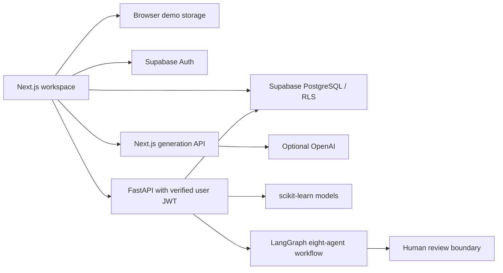

# MarketingGen AI

**A Generative AI-Driven Framework for Personalized Marketing Campaign Generation and Conversion Optimization**

A responsive marketing workspace built with Next.js, React, TypeScript, Tailwind CSS, Framer Motion, Recharts, Lucide, React Hook Form, and Zod. A separately deployable FastAPI service supplies scikit-learn models and an eight-node LangGraph marketing workflow. Supabase supplies optional authentication, PostgreSQL persistence, RLS, and private asset storage.

## What works

- All 15 workspace destinations, responsive navigation, notifications and loading/empty/error states.
- Dashboard and analytics calculated from workspace campaign records, with channel/date filters and downloadable CSV reports.
- Campaign creation, editing, duplication, deletion, planning status changes, schedules, and editable generated strategy/copy.
- Dedicated content studio with eleven formats, tone/language inputs, regeneration, editing, copy, save, export, and a persistent library.
- Customer/product CRUD, search, consent tracking, customer engagement fields, product descriptions and campaign creation from products.
- Browser K-Means clustering over standardized customer attributes; Python StandardScaler/KMeans endpoint.
- Labeled illustrative conversion scoring without a backend; real Logistic Regression and Random Forest training/prediction with a configured backend and labeled history.
- Historical-data upload and held-out accuracy, precision, recall, F1, ROC-AUC metrics. No invented model evaluation.
- Two-proportion A/B test with validity/sample-size checks and a 95% two-sided significance threshold.
- Monthly/weekly/daily campaign planning calendar.
- Validated CSV customer/product/campaign imports, preview, duplicate detection, sample templates, and import history.
- Recommendations derived from workspace records; no automatic budget or delivery actions.
- Supabase signup, login, logout and email password reset; tenant policies and database-enforced writer roles.
- 120 sample customers, 20 products, 12 campaigns and sample performance values, explicitly labeled as demo data.

## Honest operating modes

**Default deployment:** browser-local demo. Data remains in localStorage on that browser/device. It is not a shared production database. Generation uses labeled English templates without an OpenAI key. Requested non-English templates explicitly require live AI translation. Prediction scores are untrained heuristics.

**Connected mode:** configure Supabase variables and apply the migration before signup. Data is persisted as a tenant-scoped JSON workspace document in `workspace_state`. The migration also prepares normalized extension tables, but the app does not dual-write them. Browser Supabase access uses the anon key and the signed-in session, with RLS enforcing membership/writer roles. Python APIs use the same user token and RLS, never a service-role key.

**Live AI:** the server-side Next.js endpoint calls OpenAI only when `OPENAI_API_KEY` is configured. Provider errors are surfaced rather than replaced by fake live results. API usage may have provider costs; the free demo does not require this key.

**Marketing delivery:** provider adapters/OAuth are not implemented. Integration pages display setup steps and disconnected status. Campaign status and schedule changes are planning records only. No advertisements, emails, SMS or WhatsApp messages are delivered. External OAuth implementation, credentials and consent review are needed before live delivery.

## Local setup

```bash
npm ci
cp .env.example .env.local
npm run dev
```

Open `http://localhost:3000`. No credentials are required for demo mode.

```bash
cd backend
python -m venv .venv
# Windows: .venv\Scripts\activate
# macOS/Linux: source .venv/bin/activate
pip install -r requirements.txt
uvicorn app.main:app --reload --port 8000
```

Export Python environment variables in the shell before starting Uvicorn. Backend API documentation is at `/docs`. Health check: `/health`. Protected backend APIs return 503 until Supabase is configured and 401 without a valid session.

## Environment variables

| Variable | Where | Purpose |
|---|---|---|
| `NEXT_PUBLIC_SUPABASE_URL` | Next.js | Supabase project URL |
| `NEXT_PUBLIC_SUPABASE_ANON_KEY` | Next.js | Public anon key; protected by RLS |
| `OPENAI_API_KEY` | Next.js / Python server only | Optional live content generation |
| `OPENAI_MODEL` | Next.js / Python | Default `gpt-4.1-mini` |
| `NEXT_PUBLIC_BACKEND_URL` | Next.js | Separately hosted FastAPI origin |
| `SUPABASE_URL` | Python | Same Supabase project URL |
| `SUPABASE_ANON_KEY` | Python | Public anon key used with user JWT |
| `ALLOWED_ORIGINS` | Python | Comma-separated allowed frontend origins |

Never place service-role keys or AI credentials in public variables or commits.

## Supabase setup

1. Create a free Supabase project and execute `supabase/migrations/001_initial.sql` in its SQL editor.
2. Set the public URL and anon key in `.env.local` and Vercel environment variables.
3. Set Auth site URL to your frontend domain. Add `http://localhost:3000`, the production origin, and `/auth/reset` redirects to the Auth redirect allowlist.
4. Sign up a new account. A trigger creates the profile, organization, and Admin membership. Email confirmation follows your Supabase project setting.
5. Assign additional organization members through a trusted administrative process; browser users cannot modify membership or roles.
6. Analyst access is read-only at the database boundary. The app’s displayed role is informational; RLS is authoritative.

## Architecture



Agent nodes: business research from supplied records → customer intelligence → segmentation → campaign strategy → content → customer insight estimates → optimization → supervisor. Typed shared state, conditional approval branch, bounded retries, and logs are implemented. The graph does not perform external market research or deliver campaigns. Human approval is a returned checkpoint and requires resubmission with approval; durable resumable checkpoints are not configured.

ML training uses actual submitted `converted` labels with 75/25 stratified train/test splitting, train-only standardization, Logistic Regression or Random Forest. Features must be pre-outcome snapshots; independent observations are required. Repeated customers and temporal deployments require group/time-aware validation. Models are process-local and not persisted across restarts. Churn and annualized customer value are explicitly untrained historical heuristics; a learned churn/CLV or campaign forecasting model requires appropriate labeled data and is not claimed as implemented.

## Structure

```text
app/                  Next.js routing, styles, health and generation APIs
components/           Workspace and historical model-training interface
lib/                  Typed domain model, metrics, statistics, K-Means, Supabase client
backend/app/          FastAPI, ML algorithms, LangGraph workflow
backend/tests/        ML, workflow and authentication-boundary tests
supabase/migrations/  PostgreSQL schema, organization isolation, RLS, audit and storage
tests/                TypeScript domain and statistics tests
docs/                 API, architecture, security and deployment details
render.yaml           Optional free-plan Python service blueprint
```

## Validation

```bash
npm run typecheck
npm test
npm run build
npm audit
cd backend
python -m pytest tests -q
```

The frontend build uses webpack because Turbopack subprocesses failed on this Windows environment. Demo data tests are algorithm checks, not evidence of real-world predictive performance. Live Supabase isolation and provider credentials require testing against your configured project before production use. See `docs/validation.md` for observed results.

## Deployment

The Next.js root is Vercel-ready: framework Next.js, install `npm ci`, build `npm run build`. Push to GitHub and run `vercel --prod`, or import the repository in Vercel. The frontend works immediately in demo mode. Add environment variables and redeploy to enable connected services.

The Python backend is intentionally separate. Build the included Dockerfile on Render/Railway, set its environment variables, then set `NEXT_PUBLIC_BACKEND_URL` in Vercel and redeploy. `render.yaml` requests a free plan; do not select paid upgrades. Model training requires labeled historical data and an authenticated Supabase organization.

## Remaining production work

Provider OAuth/delivery adapters; durable model registry; persistent resumable agent checkpoints; concurrent document update conflict control; granular normalized relational persistence; comprehensive browser/component and live database tests; production observability and distributed rate limiting. Current throttling is process-local, so configure a platform-level quota/WAF before exposing paid AI generation at scale. SQLAlchemy and Pandas are available Python dependencies; production database access currently uses Supabase REST with the caller JWT rather than a SQLAlchemy session.
